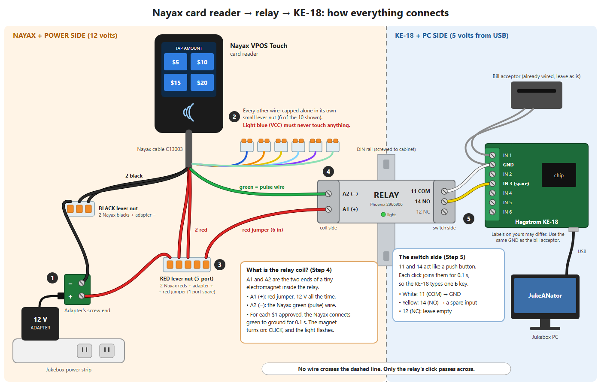

# Nayax VPOS Touch Card Reader: Pulse Integration

## How a card purchase works

1. The patron taps **$5, $10, $15 or $20** on the Nayax reader's screen. The reader has its own cancel (X) button.
2. The patron taps or swipes a card. Nayax approves the charge over its own cellular connection.
3. The reader sends **one pulse per dollar** on its Pulse 1 wire. For example, a $10 charge sends 10 pulses.
4. Each pulse clicks a relay. The relay "presses" an input on the Hagstrom KE-18 keyboard encoder, and the KE-18 types `b` on the jukebox PC.
5. For each `b`, the app does three things:
   - adds card credits (`CreditManager.addCreditCardDollar()`);
   - writes a `CREDIT_CARD` row to the financial ledger, which is counted in the bar owner's split as `card_total`;
   - shows a "Thank you" message once the pulses stop.

The pulse cable only goes one way. The reader cannot report a "card swiped" event, and the PC cannot tell the reader an amount. That is why the amount is chosen on the reader itself. An AMI-style flow, where the PC picks the amount, would need Nayax's serial **Marshall** protocol and a different cable.

With the default pricing (`credits-per-dollar: 3`, bonuses 3/10, `credit-card-cost-multiplier: 2`; see [pricing.md](pricing.md)):

- $5: 9 credits
- $10: 20 credits
- $15: 29 credits
- $20: 40 credits

When `enable-credit-card-processing` is `true`, the app logs the matching Nayax **Pulse Title 1-6** text at startup. Paste that text into Nayax Core whenever the pricing settings change.

---

## Part 1: Wiring (plain-language guide)

### Words used in this guide

- **Power supply / adapter**: A wall-plug "brick", like a laptop charger. It turns wall power into safe **12 volts DC**, about what a car battery gives. Nothing in this project touches wall (120 V) power directly.
- **+ and −**: Every DC power source has a **positive (+)** side and a **negative (−)** side. Usually the red wire is + and the black wire is −. Mixing them up can damage parts, so step 1 checks them with a meter.
- **Ground (GND)**: Another name for the **−** side, the "return path" of a circuit.
- **Relay**: A switch that electricity presses for you. Send a little power to its "coil" and an internal switch clicks shut. Remove the power and it clicks open. It lets the Nayax "press a button" on the KE-18 **without the two devices being electrically connected**, which protects both.
- **Coil terminals**: The two screws that make the relay click. They are marked **+ and −**, sometimes **A1 (+)** and **A2 (−)**.
- **COM / NO / NC**: The relay's switch screws. **COM** is "common". **NO** ("normally open") connects to COM only while the relay is clicked on. **NC** ("normally closed") is the opposite. **Only COM and NO are used.**
- **DIN rail**: A standard metal strip, about 1.4 in (35 mm) wide, that industrial parts snap onto, like a shelf bracket.
- **AWG / "gauge"**: Wire thickness. **A bigger number means a thinner wire.** 22 AWG is thin hobby wire, which is plenty for this job.
- **Lever nut (Wago)**: A small clear connector with orange levers. Lift a lever, push a stripped wire in, then close the lever. It needs no twisting or tape, and you can undo it.
- **Strip a wire**: Remove about 3/8 inch (10 mm) of plastic from the end so the bare copper shows.
- **Multimeter**: A handheld tester. You will use two settings: **DC volts** (a V with a straight line, ⎓) and **continuity** (the sound-wave symbol, which beeps when two points are connected).

### Shopping list (Amazon)

1. **12 V 3 A power adapter with screw-terminal plug ends (2-pack)**: Powers the reader and the relay. The screw-terminal end means you never cut the adapter cord. Buy: [Quentacy 12V 3A 2-pack](https://www.amazon.com/Quentacy-Converter-Transformer-5-5x2-1mm-Connector/dp/B07LDY57SQ)
2. **Phoenix Contact 2966906 relay (PLC-RSC-12DC/21)**: A 12 V relay with built-in protection, screw terminals and a status light. Buy: [Phoenix Contact 2966906](https://www.amazon.com/Phoenix-Contact-Industrial-PLC-RSC-12DC-651-2961150/dp/B082J56XFK)
3. **Short DIN rail with screws**: Mounts the relay inside the cabinet. Buy: [VAMRONE 4-inch DIN rail](https://www.amazon.com/VAMRONE-Din-Rail-4inch/dp/B0DCFN351K)
4. **WAGO 221 lever nut kit**: Joins wires and caps the unused ones. Buy: [WAGO 221 35-pc kit](https://www.amazon.com/Compact-Splicing-Connector-Assortment-221-2401/dp/B0BRBPSM9Q)
5. **22 AWG solid hookup wire (several colors)**: Short jumper wires. Buy: [TUOFENG 22 AWG solid kit](https://www.amazon.com/TUOFENG-Solid-Colors-Tinned-Copper/dp/B07TX6BX47)
6. **Self-adjusting wire stripper**: Strips insulation cleanly. Buy: [IRWIN VISE-GRIP 2078300](https://www.amazon.com/IRWIN-VISE-GRIP-2078300-Self-Adjusting-Stripper/dp/B000OQ21CA)
7. **Digital multimeter with continuity beeper**: For the safety checks. Buy: [AstroAI DM130B](https://www.amazon.com/AstroAI-Multimeter-Ohmmeter-Voltmeter-Non-Contact/dp/B0842HTN8C)
8. **Small flat screwdriver (1/8 in / 3 mm tip), zip ties, painter's tape, marker**: Usually already on hand.

Check these before ordering:
- Item 1 should say **12V, 3A, 5.5×2.1 mm, center-positive**.
- Item 2 should say **12VDC**, not 24 V.
- If item 2 is unavailable, buy the same Phoenix part number from Digi-Key, Mouser or AutomationDirect. **Do not** substitute a hobby "Arduino relay board" with an **IN** or **signal** pin. Those boards can partly switch on from the reader's idle voltage.

### Why a relay instead of a direct wire

- The reader's pulse wire sits at about **9 V while idle**.
- The KE-18's inputs run at **5 V** from USB.
- A direct wire could push 9 V into the KE-18 and damage it or the PC's USB port.
- The relay keeps the two devices apart. The Nayax pulse manual calls this the "no electronics expertise required" method.

### Which Nayax wires (cable C13003) you will use

Only **5 wires** are used. Every other wire is capped and never touches anything.

- **Red** (2 wires), labeled AC/DC IN +: connect to the adapter's **+**
- **Black** (2 wires), labeled AC/DC IN −: connect to the adapter's **−**
- **Green**, labeled Pulse 1: connect to the relay coil's **− (A2)**
- Blue, orange, yellow, white, pink, labeled Pulse 2–6: cap off
- **Light blue**, labeled VCC: **Cap off. Never connect it.**
- Brown, grey, labeled GND: cap off
- Purple, labeled Inhibit: cap off
- Light green (mint), labeled Door Open: cap off
- Any other wire: cap off

Check these colors against the tag on your cable first. If anything differs, stop and ask Nayax support (support@nayax.com) for the C13003 wire colors.

### Wiring picture



The numbered circles match the steps below. Every connection, one line each:

- **Adapter +** → RED lever nut, together with both **Nayax red** wires and one end of the **red jumper**.
- **Adapter −** → BLACK lever nut, together with both **Nayax black** wires.
- **Red jumper** (other end) → relay **A1 (+)**.
- **Nayax green** (the pulse wire) → relay **A2 (−)**.
- Relay **11 (COM)** → KE-18 **GND** (the same GND your bill acceptor uses), with a white wire.
- Relay **14 (NO)** → a **spare KE-18 input**, with a yellow wire.
- Relay **12 (NC)** → nothing.
- Every other Nayax wire → capped alone in its own small lever nut.

**What the relay coil is:** A1 and A2 are the two ends of a tiny electromagnet inside the relay. A1 gets 12 V all the time through the red jumper. When a $1 charge is approved, the Nayax connects the green wire to ground for 0.1 second. That turns the magnet on, the relay clicks and its light flashes, and the click closes the switch between 11 and 14, just like pressing a button. The KE-18 sees that "button press" and types one `b`.

The Nayax side and the KE-18 side **never share a wire**. The drawing's source file is [Nayax_Card_Reader_Wiring.svg](Nayax_Card_Reader_Wiring.svg).

### Step by step

Keep the adapter **unplugged** unless a step says otherwise. Build it on a table first.

**1. Check the adapter's + and −**
1. Plug the adapter into a screw-terminal end, then plug the adapter into the wall.
2. Set the meter to **DC volts**.
3. Put the red probe on the **+** screw and the black probe on the **−** screw. The meter should read **about 12**.
4. If it reads **−12**, the markings are swapped. Relabel them with tape.
5. Unplug the adapter.

**2. Cap the unused Nayax wires**
1. Flag the 5 wires you will use (2 red, 2 black, 1 green) with tape.
2. Strip every other wire and push each one, **alone**, into its own small Wago lever nut. Close the lever.

**3. Connect power**
1. Strip the 2 red, 2 black and 1 green wires.
2. Cut a 6-inch red jumper wire.
3. Put both reds, one end of the red jumper, and a short wire to the adapter's **+** screw into one **5-port** Wago (4 wires; one port stays empty).
4. Put both blacks and a short wire to the adapter's **−** screw into one **3-port** Wago.
5. Tug each wire gently to make sure it is held.

**4. Connect the relay coil**
1. Snap the relay onto the DIN rail.
2. Connect the red jumper to the relay's **+ (A1)** screw.
3. Connect the Nayax **green** wire to the relay's **− (A2)** screw.
4. Tighten both screws and tug-test the wires.

**5. Connect the relay switch to the KE-18**

Copy how your bill acceptor is wired: one wire goes to an input, one to ground.
1. Relay **11 (COM)** → a KE-18 **GND** terminal.
2. Relay **14 (NO)** → an **unused KE-18 input**. Write down its number.
3. Leave relay **12** empty.

**6. Meter check (adapter unplugged)**
1. Set the meter to continuity.
2. Probe relay **11–14**. It should be **silent**.
3. Probe relay **11–12**. It should **beep**.

**7. Program the KE-18**
1. Open Hagstrom's KE-USB utility.
2. Set the new input to a single lowercase **`b`**, with no auto-repeat and no macro.
3. Save it to the KE-18.

**8. Test the KE-18**
1. Open Notepad on the PC.
2. Briefly touch a wire across relay **11** and **14**.
3. Exactly one `b` should appear each time.

**9. Power up**
1. Plug in the adapter.
2. The reader should start within about 2 minutes.
3. The relay light should stay **off**. If it stays on, unplug the adapter and recheck steps 3–4.

**10. Install in the jukebox**
1. Mount the relay away from the amplifier and wall-power wiring, and off the cabinet floor.
2. Plug the adapter into the **jukebox's own power strip**. Do not power the reader from the PC or USB.
3. Zip-tie the cable so a tug on it can't pull any wires loose.

---

## Part 2: Nayax Core settings

The reader itself has no settings menu for this. Everything is set in **Nayax Core**, Nayax's web portal, and Nayax sends the settings to the reader over its own cellular connection. Menu names below come from the Nayax pulse manual, so the portal's wording may differ slightly.

### The settings

- **Decimal Place / Currency**: `2` / `USD`
- **Credit per Pulse 1**: `100` — each pulse is $1.00
- **Pulse Increment**: `5,10,15,20` — the four price buttons
- **Pulse Increment Prices**: `5.00,10.00,15.00,20.00` — optional
- **Pulse Options**: `Use Price Array for Outgoing Pulses` — needed only with Increment Prices
- **Pulse 1-6 Active Time in ms**: `100;100;100;100;100;100` — each pulse lasts 0.1 s
- **Pulse 1-6 Inactive Time in ms**: `150;150;150;150;150;150` — 0.15 s gap between pulses
- **Pulse Invert**: No invert (default)
- **Pulse Inhibit**: `0` — the purple wire is not used
- **Pulse line welcome message**: `TAP AMOUNT FOR SONG CREDITS`
- **Pulse Title 1-6**: e.g. `9 CREDITS;20 CREDITS;29 CREDITS;40 CREDITS` — copy this from the app's startup log

### Finding the Pulse Title text

`Pulse Title 1-6` is the small text shown under each price button on the reader's screen. With the titles above, a patron sees "9 CREDITS" under the $5 button, "20 CREDITS" under $10, and so on.

The app works out this text from your pricing settings and writes it to its log file each time it starts, as long as `enable-credit-card-processing: true` is set. The log line looks like this:

```
... JukeANatorFrame - Card reader enabled. Nayax Pulse Title 1-6 for prices [5, 10, 15, 20]: 9 CREDITS;20 CREDITS;29 CREDITS;40 CREDITS
```

The part after the last colon, `9 CREDITS;20 CREDITS;29 CREDITS;40 CREDITS`, is what goes into the `Pulse Title 1-6` field in Nayax Core, or what you read to Nayax support.

**Where the log is:** `logs\jukeanator-service.log`, inside the folder the app was started from (the `app.logging.file-path` setting).
- Run from Eclipse: `C:\dev-wks\projects\jukeanator-engine\logs\jukeanator-service.log`
- On the jukebox: the `logs` folder inside whatever folder the app runs from, for example `C:\kiosk\logs\jukeanator-service.log`

Open the file in Notepad and search for `Pulse Title`.

**You may not need the log at all.** With the default prices (`credits-per-dollar: 3`, bonuses 3 and 10, `credit-card-cost-multiplier: 2`) the text is always `9 CREDITS;20 CREDITS;29 CREDITS;40 CREDITS`. Check the log again only after changing one of those settings.

### Why each one matters to the app

- **One pulse = $1** (`Credit per Pulse 1` = `100`, with `Decimal Place` `2` and `USD`). The app adds one dollar's worth of credits and writes one ledger entry for each pulse. Any other value credits the wrong amount and puts the wrong card total in the owner's split.
- **The price buttons** (`Multiple Price → Price List`, `Pulse Increment` = `5,10,15,20`). These must match `KioskCreditMath.CARD_READER_PRICE_DOLLARS` in the code. An amount that isn't on the list would still be credited correctly, pulse by pulse, but the button titles and the startup price check only cover these four amounts.
- **Pulse timing** (`Active` 100 ms, `Inactive` 150 ms). The KE-18 needs each pulse long enough to register one `b`. The app treats a purchase as finished after 1.5 s with no pulse, so the gap between pulses must stay well under that, or one purchase shows up as several "thank you" messages.
- **Button titles** (`Pulse Title 1-6`). The credit amounts come from the app's pricing settings, so this is the setting most likely to go out of date (see "When to update the reader again" below).
- **Inhibit off and no invert** (`Pulse Inhibit` = `0`, `Pulse Invert` at its default). The purple Inhibit wire isn't connected, and a pulse must pull the green wire down for the relay to click.
- **Welcome message** (optional): the text at the top of the reader's screen.

### How to apply them yourself

1. Sign in to Nayax Core and go to **Operations → Machines → *your machine* → General → Pulse/ccTalk**.
2. Run the **Pulse Wizard** to put the reader in pulse mode, and choose **Multiple Price → Price List**.
3. Enter the settings above and save.
4. Run **Actions → Update Queue**, then **Actions → Restart Device**. The reader downloads the settings over its cellular connection and restarts.
5. If the reader's screen doesn't change, run **Reset Default Parameters → Reload Configuration → Restart Device**.

Before any of this, the reader must be activated in Nayax Core: linked to a machine and to your merchant account. Your Nayax distributor normally does that during setup, and they can also enter the pulse settings for you (see "What to ask Nayax support" below).

### When to update the reader again

- **After changing the app's pricing settings** (`credits-per-dollar`, `five-dollar-bonus-credits`, `ten-dollar-bonus-credits` or `credit-card-cost-multiplier`): restart the app, copy the new `Pulse Title 1-6` text from the startup log into Nayax Core, then run **Update Queue** and **Restart Device**. The credits awarded follow the app's settings automatically; only the button labels go out of date.
- **After changing the price buttons themselves**: change both `Pulse Increment` in Nayax Core and `CARD_READER_PRICE_DOLLARS` in `KioskCreditMath`. If $5, $10 or $20 change, also update `CARD_LINE_PRICE_DOLLARS` in `JukeANatorFrame`, which sets the amounts on the jukebox screen's CARD line. Both lists are in the code, not `application.yml`, so this needs a new build.
- **After lengthening the gap between pulses beyond about 1 s**: raise `CARD_PURCHASE_QUIET_PERIOD_MS` in `JukeANatorFrame` to match.

### What to ask Nayax support

Before calling, have ready:
- the reader's **serial number** (on the label on the back of the reader, or on its box);
- your **Nayax account / merchant details**;
- the jukebox's **location name and address**;
- the **Pulse Title** text from the app's startup log (start the app once with `enable-credit-card-processing: true` to get it).

Then ask, in this order:

1. **Activation.** "Please activate this VPOS Touch, link it to a machine for this location, and connect it to my merchant account so it can take card payments."
2. **Mode and cable.** "Set it to **Pulse** mode for the standard pulse cable, **C13003**, using **Pulse 1** on the green wire. Use **Multiple Price → Price List**."
3. **The values.** Read them the list:
   - Decimal Place `2`, Currency `USD`
   - Credit per Pulse 1: `100` (one pulse per dollar)
   - Pulse Increment: `5,10,15,20`
   - Pulse 1-6 Active Time: `100` ms on all lines
   - Pulse 1-6 Inactive Time: `150` ms on all lines
   - Pulse Invert: no invert
   - Pulse Inhibit: `0` (not used)
   - Pulse line welcome message: `TAP AMOUNT FOR SONG CREDITS`
   - Pulse Title 1-6: the text from the startup log, e.g. `9 CREDITS;20 CREDITS;29 CREDITS;40 CREDITS`
4. **Send them to the reader.** "Please push the configuration to the device and restart it" (their **Update Queue** and **Restart Device**).
5. **Confirm.** Ask them to confirm that the reader's screen shows the four buttons ($5, $10, $15, $20) with your titles under them.
6. **Fees (optional).** Ask what the monthly fee and per-transaction fees are, so you can check that `credit-card-cost-multiplier` still covers them (see [pricing.md](pricing.md)).

Then do the final test in Part 4: buy $5 with a real card and check that the app adds the right credits and shows the "Thank you" message. Refund the test charge in Nayax Core afterward if you like.

---

## Part 3: Turning it on in the app

In the running config file (`C:\kiosk\config\application.yml`), under `user-interface:`:

```yaml
increment-credits-credit-card-reader-key: b
enable-credit-card-processing: true
```

Restart the app. The credits panel then shows a `CARD:` pricing line.

## Part 4: Final test

1. With Notepad open (before enabling the app setting), buy $5 with a real card. You should hear 5 relay clicks and see `bbbbb`.
2. Repeat with $10 and $20. Expect exactly 10 and 20 `b`s.
3. With the app running, buy $5. Credits should rise by 9 and the "Thank you" message should appear.
4. Check that the admin panel's financial ledger shows the card total.
5. Refund the test charges in Nayax Core if you want to.

## Part 5: Final checklist

Everything left to do before the jukebox takes card payments at the bar, in order. Each item points to where the details are.

**Software (on the development PC)**
1. **Build and test.** The code changes for the card reader and the pricing cleanup have not been compiled or tested yet. Run the full test suite (for example `mvnw test`, or from Eclipse) and fix anything that fails.
2. **Check the prices.** Review the pricing settings in [pricing.md](pricing.md): `credits-per-dollar`, the two bonus settings, `credit-card-cost-multiplier`, `web-cost-multiplier` and `add-funds.packages`. Start the app and check its log for `PricingStartupCheck` warnings; with the defaults there are none.

**The jukebox's config file (`C:\kiosk\config\application.yml`)**
3. **Set the mode.** `app.mode` is currently `slave`. Set it to the mode the jukebox will actually run in at the bar (`standalone` or `slave`).
4. **Leave the card reader off for now.** Keep `enable-credit-card-processing: false` until the wiring is done (Part 3 turns it on), so patrons don't see card prices before the reader works.
5. **Email (only if this jukebox handles web sign-ups).** Set up outgoing email and remove the legacy `receipt:` block; see Part 3 of [EmailService.md](EmailService.md). Until then, new web accounts can't verify their email address and can't sign in.

**Hardware (Part 1)**
6. **Buy the parts** from the shopping list.
7. **Check the cable's wire colors** against the tag on your C13003 cable. If anything differs, stop and ask Nayax support for the correct colors.
8. **Wire it on a table first**, following steps 1 to 9 of "Step by step", including the meter checks.
9. **Program the KE-18** input to a single lowercase `b` (step 7), and check in Notepad that touching relay screws 11 and 14 types exactly one `b` (step 8).
10. **Install it in the jukebox** (step 10), with the adapter plugged into the jukebox's own power strip.

**Nayax reader (Part 2)**
11. **Get the Pulse Title text** (see "Finding the Pulse Title text"). With the default prices it is `9 CREDITS;20 CREDITS;29 CREDITS;40 CREDITS`.
12. **Activate and configure the reader**, either yourself in Nayax Core ("How to apply them yourself") or by calling Nayax support with "What to ask Nayax support".
13. **Confirm the reader's screen** shows the $5, $10, $15 and $20 buttons with the credit titles under them.
14. **Ask about the fees** (monthly and per transaction) and check that `credit-card-cost-multiplier` still covers them ([pricing.md](pricing.md)).

**Go live**
15. **Notepad test** (Part 4, steps 1 and 2): real $5, $10 and $20 purchases type exactly 5, 10 and 20 `b`s.
16. **Turn the card reader on in the app** (Part 3): set `enable-credit-card-processing: true` and restart. The jukebox screen now shows the `CARD:` line.
17. **App test** (Part 4, steps 3 and 4): a $5 purchase adds 9 credits, shows the "Thank you" message, and appears as a card total in the admin panel's financial ledger.
18. **Refund the test charges** in Nayax Core if you want to.

**Later, whenever prices change**
19. After changing `credits-per-dollar`, a bonus setting or `credit-card-cost-multiplier`, restart the app and update `Pulse Title 1-6` in Nayax Core ("When to update the reader again").

## References

- Nayax Pulse Manual: https://nayax-u.nayax.com/article/nayax-pulse-manual-11705
- Pulse Hardware Installation: https://nayax-u.nayax.com/article/pulse-hardware-installation-11793
- Pulse modes: https://nayax-u.nayax.com/article/understanding-nayax-pulse-modes-a-complete-guide-61292
